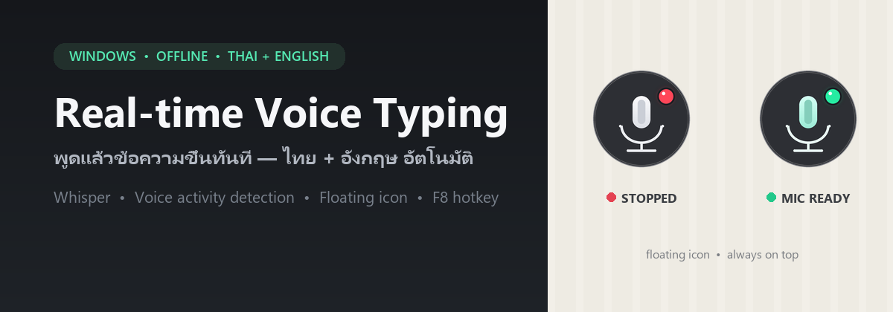
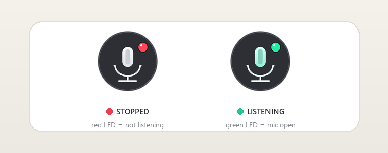

<div align="center">
  
</div>

<h1 align="center">Real-time Voice Typing</h1>

<p align="center">
  พูดแล้วพิมพ์ทันที ไทย + อังกฤษ &nbsp;•&nbsp; ถอดเสียงในเครื่อง 100% &nbsp;•&nbsp; ใช้ได้กับทุกแอปบน Windows
</p>

<p align="center">
  
  
  
  
</p>

> **สรุปสั้น ๆ** — เปิดโปรแกรม เปิดฟังค้างไว้ แล้วพูดได้เรื่อย ๆ เมื่อหยุดพักประมาณ 0.7 วินาที ข้อความจะถูกพิมพ์ลงช่องที่กำลังโฟกัสอยู่ให้อัตโนมัติ รองรับไทยและอังกฤษปนกัน โดยตรวจภาษาจากเสียงจริง ไม่ต้องสลับภาษาเอง

---

## สารบัญ

- [ฟีเจอร์](#ฟีเจอร์)
- [ภาพตัวอย่าง](#ภาพตัวอย่าง)
- [ความต้องการของระบบ](#ความต้องการของระบบ)
- [สเปคแต่ละโมเดล](#สเปคแต่ละโมเดล)
- [การติดตั้ง](#การติดตั้ง)
- [วิธีใช้](#วิธีใช้)
- [โหมดไอคอนลอย](#โหมดไอคอนลอย)
- [การเลือกโมเดล](#การเลือกโมเดล)
- [โมเดลไทย (ไม่รวมใน repo)](#โมเดลไทย-ไม่รวมใน-repo)
- [Text Destination](#text-destination)
- [โครงสร้างโปรเจกต์](#โครงสร้างโปรเจกต์)
- [ปรับแต่ง](#ปรับแต่ง)
- [พัฒนาและทดสอบ](#พัฒนาและทดสอบ)
- [แก้ปัญหาที่พบบ่อย](#แก้ปัญหาที่พบบ่อย)
- [ความเป็นส่วนตัว](#ความเป็นส่วนตัว)
- [License & Credits](#license--credits)
- [English overview](#english-overview)

## ฟีเจอร์

- **พูดต่อเนื่องไม่ต้องกดทุกประโยค** — ระบบ VAD (Voice Activity Detection) ตัดจังหวะเมื่อคุณหยุดพูด แล้วถอดเสียงทันที
- **ไทย + อังกฤษ อัตโนมัติ** — Whisper ตรวจภาษาจากเสียงจริง รองรับประโยคที่พูดปนกัน
- **พิมพ์แบบ Unicode ไม่แย่ง clipboard** — ใช้ `SendInput` ส่งตัวอักษรโดยตรง ภาษาไทยจึงไม่เพี้ยนและ clipboard เดิมยังอยู่
- **ทำงานในเครื่อง 100%** — หลังดาวน์โหลดโมเดลครั้งแรกแล้ว ใช้งานออฟไลน์ได้ ไม่มีการส่งเสียงออกอินเทอร์เน็ต
- **โหมดไอคอนลอย always-on-top** — วงกลมเล็ก ๆ ลากย้ายได้ คลิกเดียวเริ่ม/หยุด คลิกขวาเปลี่ยนโหมด
- **สถานะชัดเจน** — ไฟ LED **แดง = หยุดอยู่**, **เขียว = ไมโครโฟนเปิดและกำลังฟังจริง**
- **เลือกโมเดลและปลายทางข้อความได้ในแอป** — พร้อมข้อมูลสเปคและปุ่มตรวจสเปคเครื่องแบบ on-demand
- **เปิดโปรแกรมเร็ว** — ไม่ตรวจ CPU/GPU อัตโนมัติตอนเปิดแอป จะตรวจเมื่อกดปุ่ม “ตรวจสเปคเครื่อง” เท่านั้น (ครั้งแรกอาจใช้เวลาราว 5–10 วินาที เพราะโหลด CUDA)
- **เรนเดอร์ไอคอนด้วย per-pixel alpha** — ขอบวงกลมและไมค์คม ไม่มีขอบสีชมพูหรือจุดทะลุแบบ color-key

## ภาพตัวอย่าง

<p align="center">
  
</p>

## ความต้องการของระบบ

### ขั้นต่ำ

| รายการ | ขั้นต่ำ |
|---|---|
| ระบบปฏิบัติการ | Windows 10 / 11 (64-bit) — แอปใช้ Win32 API โดยตรง |
| Python | 3.10 – 3.13 (ทดสอบบน 3.13) |
| ไมโครโฟน | 1 ตัว (ค่าเริ่มต้นของ Windows) |
| RAM | 8 GB (โมเดล Small) / 16 GB (Turbo ขึ้นไป) |
| ดิสก์ว่าง | ~3 GB (Turbo) / ~12 GB (เก็บครบทุกโมเดล) |
| GPU | ไม่จำเป็น — รันบน CPU ได้ แต่จะช้ากว่า |

### แนะนำ

- GPU NVIDIA **VRAM 6–8 GB** ขึ้นไป (เช่น RTX 3050 / 3060 / 4060)
- RAM **16 GB**
- SSD สำหรับโหลดโมเดลเร็วขึ้น

### ภาระของโปรแกรม

| สถานะ | CPU | RAM | VRAM |
|---|---|---|---|
| เปิดทิ้งไว้ ยังไม่กด Start | ~0–2% | ~150–300 MB | 0 MB |
| กำลังฟัง แต่ยังไม่พูด | ~2–5% | ~150–300 MB | ตามขนาดโมเดลที่โหลดไว้ |
| จังหวะถอดเสียง | พุ่งสั้น ๆ 0.1–0.6 วินาที (GPU) หรือ 0.5–4 วินาที (CPU) | — | ตามโมเดล |

## สเปคแต่ละโมเดล

| โมเดลในแอป | ภาษา | ไฟล์โมเดล | VRAM (GPU) | RAM (CPU) | สเปคแนะนำ |
|---|---|---:|---:|---:|---|
| **Small** | ไทย + อังกฤษ | ~0.5 GB | ~0.8–1.2 GB | ~1.0–1.5 GB | CPU 6 คอร์ หรือ GPU 4 GB VRAM |
| **Medium** | ไทย + อังกฤษ | ~1.5 GB | ~1.8–2.5 GB | ~2.0–3.0 GB | GPU 6 GB VRAM (RTX 2060/3050), RAM 16 GB |
| **Turbo** *(ค่าเริ่มต้น)* | ไทย + อังกฤษ | ~1.6 GB | ~1.8–2.4 GB | ~2.0–3.0 GB | GPU 6–8 GB VRAM (RTX 3050/3060/4060), RAM 16 GB |
| **Thai Distill** | ไทยล้วน | ~1.55 GB | ~1.8–2.4 GB | ~2.0–3.0 GB | GPU 6–8 GB VRAM, RAM 16 GB |
| **Large v3** | ไทย + อังกฤษ | ~3.0 GB | ~3.3–4.2 GB | ~3.5–5.0 GB | GPU 8 GB VRAM+ (RTX 3060/4060), RAM 16 GB |
| **Pathumma** | ไทย + อังกฤษ | ~2.95 GB | ~3.3–4.2 GB | ~3.5–5.0 GB | GPU 8 GB VRAM+ (RTX 3060/4060), RAM 16–32 GB |

> **หมายเหตุ**
> - `Large v3` และ `Pathumma` ไม่แนะนำให้รันบน CPU ล้วน เพราะประโยคอาจใช้เวลาหลายวินาที
> - ตัวเลขเป็นค่าประมาณสำหรับการใช้งานจริง ไม่ใช่ peak สูงสุดของไลบรารี
> - ในแอปมีปุ่ม **“สเปคแต่ละโมเดล”** และปุ่ม **“ตรวจสเปคเครื่อง”** สำหรับตรวจ CPU threads, RAM, GPU/VRAM และ CUDA แบบ on-demand (ไม่ตรวจอัตโนมัติตอนเปิดโปรแกรม)

## การติดตั้ง

### 1) โคลนโปรเจกต์

```powershell
git clone https://github.com/fiwflash/realtime-voice-typing.git
cd realtime-voice-typing
```

### 2) สร้าง virtual environment (แนะนำ)

```powershell
python -m venv .venv
.\.venv\Scripts\Activate.ps1
```

> ถ้า PowerShell บล็อกสคริปต์ ให้รัน `Set-ExecutionPolicy -Scope Process -ExecutionPolicy Bypass` ก่อน แล้วค่อย activate ใหม่

### 3) ติดตั้ง dependencies

```powershell
python -m pip install --upgrade pip
python -m pip install -r requirements.txt
```

### 4) (ถ้ามี GPU NVIDIA) ติดตั้ง CUDA runtime

ไม่ต้องลง CUDA Toolkit ทั้งชุด ขอแค่มีไดรเวอร์ NVIDIA ที่ใหม่พอ แล้วติดตั้ง wheel เหล่านี้:

```powershell
python -m pip install -r requirements-cuda.txt
```

โค้ดจะค้นหา DLL ของ CUDA ที่ติดตั้งผ่าน pip ให้เอง และเลือก `cuda` อัตโนมัติถ้าใช้ได้ (ไม่ต้องแก้ PATH)

### 5) เปิดโปรแกรม

```powershell
python run_realtime.py
```

หรือดับเบิลคลิก `start_realtime.bat`

> **ครั้งแรกจะดาวน์โหลดโมเดล Turbo (~1.6 GB)** จาก Hugging Face ลงแคชในเครื่อง หลังจากนั้นเปิดใช้ออฟไลน์ได้เลย

## วิธีใช้

1. เปิดแอป แล้วเปิดโปรแกรมที่ต้องการพิมพ์ (Notepad, Word, เบราว์เซอร์, แชต ฯลฯ)
2. กด **`F8`** หรือคลิก **Start Listening**
3. คลิกกลับไปที่ช่องข้อความเป้าหมาย
4. พูดไปเรื่อย ๆ — ข้อความจะโผล่ทีละประโยคเมื่อคุณหยุดพัก
5. กด **`F8`** อีกครั้ง หรือคลิก **Stop Listening** เพื่อหยุด

- ข้อความจะถูกพิมพ์ต่อท้ายช่องที่โฟกัสอยู่ พร้อมเว้นวรรคหนึ่งครั้ง
- ระบบจะถอดเสียง **ทั้งประโยค** เมื่อจบ utterance จึงแม่นกว่าการถอดทีละคำ แต่จะมีความหน่วงเท่าระยะเงียบ (ค่าเริ่มต้น 0.7 วินาที)
- ถ้าพูดยาวเกิน 20 วินาที ระบบจะตัดและถอดเสียงเป็นช่วงให้อัตโนมัติ

## โหมดไอคอนลอย

คลิก **Icon mode** หรือคลิกขวาที่หน้าต่าง แล้วเลือก **Icon mode** เพื่อย่อเป็นไอคอนวงกลมลอย:

| การกระทำ | ผล |
|---|---|
| **คลิกซ้าย** | เริ่ม / หยุดฟัง |
| **ลาก** | ย้ายตำแหน่งไอคอน |
| **คลิกขวา** | เมนู: กลับ Full mode / Exit |
| **ไฟ LED แดง** | หยุดอยู่ — ไมโครโฟนยังไม่เปิด |
| **ไฟ LED เขียว + ไมค์สีมิ้นต์** | กำลังฟัง — ไมโครโฟนเปิดจริง |

ไอคอนเป็นหน้าต่าง Win32 แบบ layered ที่เรนเดอร์จาก PNG 256×256 ด้วย per-pixel alpha จึงคมทุกขนาดหน้าจอ และไม่เกิดขอบสีแปลกปลอม

## การเลือกโมเดล

เลือกได้จากช่อง **Model** ในหน้า Settings แล้วกด **Apply**:

- โมเดลมาตรฐาน `Turbo`, `Large v3`, `Medium`, `Small` จะดาวน์โหลดจาก Hugging Face อัตโนมัติเมื่อใช้ครั้งแรก
- ใต้ช่อง Model จะแสดง **VRAM/RAM/สเปคแนะนำ** ของโมเดลที่เลือกแบบคงที่ (ไม่ตรวจเครื่องอัตโนมัติตอนเปิดโปรแกรม)
- กดปุ่ม **“ตรวจสเปคเครื่อง”** (หรือเปิดหน้าต่าง **“สเปคแต่ละโมเดล”**) เพื่อตรวจ CPU/RAM/GPU จริงของเครื่อง — ครั้งแรกอาจใช้เวลาราว 5–10 วินาที เพราะต้องโหลด CUDA แต่ทำงานเบื้องหลัง UI ไม่ค้าง
- หลังตรวจแล้ว ถ้าเครื่องไม่มี CUDA หรือ VRAM น้อยกว่าที่แนะนำ ระบบจะขึ้นคำเตือนสีส้มและแนะนำให้ใช้ Turbo หรือ Small
- ปุ่ม **“สเปคแต่ละโมเดล”** เปิดตารางเปรียบเทียบครบทั้ง 6 โมเดล

## โมเดลไทย (ไม่รวมใน repo)

โมเดลที่แปลงเป็น CTranslate2 แล้วมีขนาดใหญ่ (รวม ~4.4 GB) จึง **ไม่ถูกอัปโหลดขึ้น Git** โปรเจกต์จะแสดงตัวเลือกเหล่านี้ใน dropdown ก็ต่อเมื่อพบโฟลเดอร์จริงในเครื่อง:

- `models/th-distill` — [biodatlab/distill-whisper-th-large-v3](https://huggingface.co/biodatlab/distill-whisper-th-large-v3) (MIT) — ไทยล้วน, WER ~6.8%
- `models/th-pathumma` — [nectec/Pathumma-whisper-th-large-v3](https://huggingface.co/nectec/Pathumma-whisper-th-large-v3) (Apache-2.0) — ไทย + อังกฤษ

ถ้าต้องการใช้โมเดลเหล่านี้ ให้แปลงเองด้วยคำสั่งด้านล่าง (ต้องมีพื้นที่ว่างหลาย GB และควรมี GPU สำหรับขั้นตอนแปลง):

```powershell
python -m pip install "transformers>=4.40" "torch>=2.1"

ct2-transformers-converter --model biodatlab/distill-whisper-th-large-v3 --output_dir models/th-distill --quantization float16 --copy_files tokenizer.json preprocessor_config.json

ct2-transformers-converter --model nectec/Pathumma-whisper-th-large-v3 --output_dir models/th-pathumma --quantization float16 --copy_files tokenizer.json preprocessor_config.json
```

> ชื่อโฟลเดอร์ต้องเป็น `th-distill` และ `th-pathumma` ตามที่กำหนด แอปจะตรวจพบและเพิ่มเข้า dropdown ให้เอง

## Text Destination

| โหมด | พฤติกรรม |
|---|---|
| **Follow Cursor** *(ค่าเริ่มต้น)* | พิมพ์ลงหน้าต่างที่โฟกัสอยู่ตอนนั้น ถ้าโฟกัสอยู่ที่ตัวแอปเองจะใช้หน้าต่างภายนอกล่าสุดแทน |
| **Last focused window** | จำหน้าต่างภายนอกล่าสุดที่คุณคลิกไว้ แล้วพิมพ์ลงหน้าต่างนั้นเสมอ แม้ตอนนี้จะโฟกัสที่ตัวแอป |

วิธีใช้ **Last focused window**:

1. คลิกที่ช่องข้อความเป้าหมายหนึ่งครั้ง
2. กลับมาคลิก Start Listening ในแอป
3. พูด — ข้อความจะไปที่ช่องเป้าหมายที่คลิกไว้ล่าสุด

## โครงสร้างโปรเจกต์

```text
realtime-voice-typing/
├─ run_realtime.py              # entry point
├─ start_realtime.bat           # double-click launcher
├─ requirements.txt             # runtime dependencies
├─ requirements-cuda.txt        # optional NVIDIA CUDA runtime
├─ assets/
│  ├─ voice_icon_idle.png       # 256px source art (stopped / red)
│  ├─ voice_icon_listening.png  # 256px source art (listening / green)
│  ├─ VoiceTyping.ico           # multi-size app icon
│  ├─ banner.png                # README hero image
│  ├─ preview.png               # README state preview
│  └─ custom/                   # reserved for user-supplied icons
├─ src/realtime_voice_typing/
│  ├─ app.py                    # capture → VAD → transcribe → insert loop
│  ├─ audio.py                  # sounddevice input stream
│  ├─ gui.py                    # Tkinter UI + layered floating icon
│  ├─ inserter.py               # Unicode SendInput / clipboard fallback
│  ├─ settings.py               # defaults, model list, model specs
│  ├─ speech.py                 # faster-whisper engine + CUDA DLL setup
│  ├─ vad.py                    # energy-based utterance segmentation
│  └─ windows_target.py         # foreground-window tracking
├─ tests/                       # unit tests (pytest)
└─ models/                      # local converted models (git-ignored)
```

## ปรับแต่ง

แก้ค่าเริ่มต้นได้ใน `src/realtime_voice_typing/settings.py`:

| ค่า | ค่าเริ่มต้น | ความหมาย |
|---|---:|---|
| `silence_seconds` | `0.7` | ระยะเงียบที่ถือว่าจบประโยค |
| `min_speech_seconds` | `0.4` | ตัดเสียงรบกวนที่สั้นกว่านี้ทิ้ง |
| `pre_roll_seconds` | `0.25` | เก็บเสียงก่อนเริ่มพูด เพื่อไม่ตัดคำแรกหาย |
| `max_utterance_seconds` | `20.0` | ตัดประโยคที่ยาวเกินกำหนด |
| `insert_method` | `"unicode"` | `"unicode"` (SendInput) หรือ `"clipboard"` (Ctrl+V) |
| `destination_mode` | `"follow_cursor"` | `"follow_cursor"` หรือ `"last_focus"` |
| `hotkey` | `"f8"` | ปุ่มลัดเริ่ม/หยุด |
| `device` | `"auto"` | `"auto"`, `"cuda"`, `"cpu"` |
| `compute_type` | `"auto"` | `"auto"`, `"float16"`, `"int8"`, `"int8_float16"` |

## พัฒนาและทดสอบ

```powershell
# รัน unit tests
python -m pytest tests -q
```

ชุดทดสอบครอบคลุม VAD, Unicode inserter, window tracking และข้อมูลสเปคโมเดล — ไม่ต้องใช้ไมโครโฟนหรือ GPU

โครงสร้างโค้ดแยกส่วนชัดเจน: `app.py` เป็นตัวควบคุมหลัก, `speech.py` รับผิดชอบโมเดล, `gui.py` เป็น UI และไอคอนลอย

## แก้ปัญหาที่พบบ่อย

<details>
<summary><b>ตรวจไม่พบ GPU / ใช้ CPU อยู่</b></summary>

1. อัปเดตไดรเวอร์ NVIDIA
2. ติดตั้ง `python -m pip install -r requirements-cuda.txt`
3. ทดสอบว่า CTranslate2 มองเห็น CUDA:
   ```powershell
   python -c "import ctranslate2; print(ctranslate2.get_supported_compute_types('cuda'))"
   ```
4. ถ้ายังไม่เห็น ให้รีสตาร์ตเครื่องหรือรีสตาร์ตโปรแกรมหลังติดตั้ง wheel
</details>

<details>
<summary><b>ขึ้น Microphone error</b></summary>

- ตรวจว่า Windows อนุญาตให้แอปเข้าถึงไมโครโฟน: **Settings → Privacy & security → Microphone**
- ตั้งค่า default input device ให้ถูกต้อง
- ปิดโปรแกรมอื่นที่ยึดไมโครโฟนแบบ exclusive อยู่
</details>

<details>
<summary><b>พูดแล้วข้อความไม่ขึ้นในบางแอป</b></summary>

- แอปที่รันด้วยสิทธิ์ Administrator มักไม่รับ `SendInput` จากแอปธรรมดา → ลองเปิดโปรแกรมนี้แบบ Run as administrator
- เกมหรือแอปที่บล็อกการ inject อาจใช้ไม่ได้ → เปลี่ยน `insert_method` เป็น `"clipboard"` ใน `settings.py`
</details>

<details>
<summary><b>กด F8 แล้วไม่ทำงาน</b></summary>

- `keyboard` ต้องการสิทธิ์ที่สูงกว่าในบางหน้าต่าง → ลอง Run as administrator
- ใช้ปุ่ม Start/Stop ในหน้าต่างหรือคลิกไอคอนลอยแทนได้
</details>

<details>
<summary><b>ไอคอนลอยไม่ทับเกมเต็มจอ</b></summary>

หน้าต่าง always-on-top ไม่สามารถทับ exclusive fullscreen ได้ ให้เปลี่ยนเกมเป็นโหมด **borderless windowed**
</details>

<details>
<summary><b>ครั้งแรกช้ามาก</b></summary>

ครั้งแรกต้องดาวน์โหลดและโหลดโมเดลเข้าหน่วยความจำ (มีข้อความ “Loading model...” ) หลังจากนั้นการถอดเสียงแต่ละประโยคจะเร็วขึ้นมาก
</details>

## ความเป็นส่วนตัว

- เสียงถูกประมวลผลในเครื่องด้วย faster-whisper ไม่มีการส่งเสียงไปเซิร์ฟเวอร์
- ระหว่างถอดเสียง โปรแกรมจะเขียนไฟล์ WAV ชั่วคราวในโฟลเดอร์ temp แล้วลบทิ้งทันที
- การเชื่อมต่ออินเทอร์เน็ตใช้เฉพาะตอนดาวน์โหลดโมเดลครั้งแรกจาก Hugging Face เท่านั้น

## License & Credits

โค้ดในโปรเจกต์นี้อยู่ภายใต้สัญญาอนุญาต **MIT** — ดูรายละเอียดใน [LICENSE](LICENSE)

โปรเจกต์นี้ใช้ไลบรารีและโมเดลของบุคคลอื่น:

| รายการ | License |
|---|---|
| [faster-whisper](https://github.com/SYSTRAN/faster-whisper) / [CTranslate2](https://github.com/OpenNMT/CTranslate2) | MIT |
| [OpenAI Whisper](https://github.com/openai/whisper) | MIT |
| [BiodatLab Distill Whisper Thai](https://huggingface.co/biodatlab/distill-whisper-th-large-v3) | MIT |
| [NECTEC Pathumma Whisper](https://huggingface.co/nectec/Pathumma-whisper-th-large-v3) | Apache-2.0 |

ดูรายละเอียดทั้งหมดได้ที่ [THIRD_PARTY_NOTICES.md](THIRD_PARTY_NOTICES.md)

> ซอฟต์แวร์นี้พัฒนาขึ้นโดยได้รับความช่วยเหลือจาก AI และผ่านการทดสอบการใช้งานจริง ไม่ได้มีความเกี่ยวข้องหรือได้รับการรับรองจาก OpenAI, BiodatLab หรือ NECTEC

## English overview

**Real-time Voice Typing** is a Windows desktop dictation app for Thai + English. It listens continuously, detects when you pause, transcribes the utterance locally with [faster-whisper](https://github.com/SYSTRAN/faster-whisper), and types the text into the focused window with Unicode `SendInput` (no clipboard hijacking).

**Highlights**

- Continuous listening with pause-based segmentation (~0.7 s)
- Automatic Thai/English language detection
- 100% local inference after the first model download
- Full window + always-on-top floating icon (click = start/stop, drag = move, right-click = menu)
- Clear status LED: red = stopped, green = microphone open
- Model picker with on-demand hardware check and a full spec comparison table
- Crisp per-pixel-alpha icon rendering (no color-key fringing)

**Quick start** (Windows 10/11, Python 3.10–3.13)

```powershell
git clone https://github.com/fiwflash/realtime-voice-typing.git
cd realtime-voice-typing
python -m venv .venv
.\.venv\Scripts\Activate.ps1
python -m pip install -r requirements.txt
# optional, for NVIDIA GPUs:
python -m pip install -r requirements-cuda.txt
python run_realtime.py
```

Press `F8` (or click **Start Listening**), focus the target text field, and speak. Text is inserted when you pause. The first run downloads the Turbo model (~1.6 GB); afterwards the app works offline.

**Models:** Small / Medium / Turbo / Large v3 download automatically. The Thai-specific `th-distill` and `th-pathumma` models are optional local CTranslate2 conversions and are not included in this repository (see the Thai section above).

**Tests:** `python -m pytest tests -q`

**License:** MIT for this repository's code. Third-party models and libraries keep their own licenses — see [THIRD_PARTY_NOTICES.md](THIRD_PARTY_NOTICES.md).
